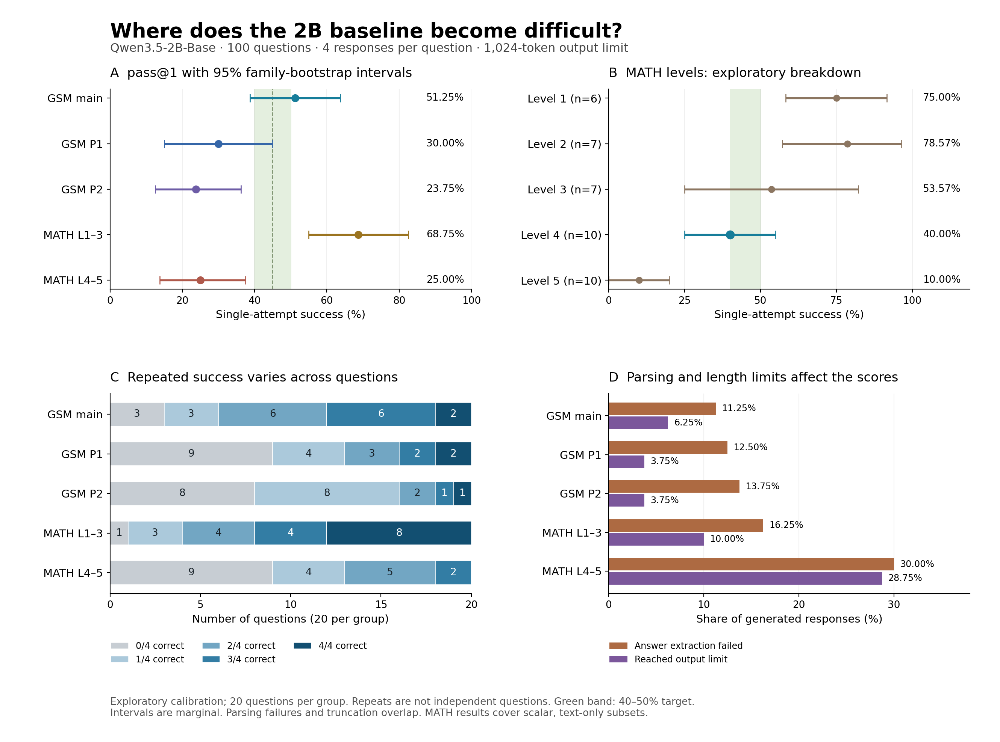

# 100 题 Baseline 难度校准复核 / Boundary calibration review

本轮运行完整。在原定五个大组中，GSM-Symbolic main 最接近 40%–50% 单次正确率目标，固定判分下为 51.25%；这五组均未严格落入目标区间。进一步按 MATH 原始等级拆开，Level 4 的 10 题得到 40%，是另一个候选，但样本小且存在截断。P1/P2 已明显更难；MATH Level 4–5 同时受到输出长度限制。判分还有少量可见漏判，因此这些结果适合确定下一轮方向，尚不能冻结为精确能力边界。

## 完整性与复现

- 下载包的 26 项源码/配置/数据/文档哈希通过；100 个题目 ID、每题 4 个样本索引、共 400 条回答完整且无重复。两个分片各 200 条，五组各 80 条。
- 两个 worker 退出码均为 0，无 infrastructure_errors.jsonl。原始 Base 身份为 `807045c0c4d4abf41d3644c7587894102f9d60e219367a1ef45b30c60a05c181`，adapter 为 null。数据及评测源码与本地固定版本一致。
- 本地使用归档代码重新合并、重放全部评分并重算 2,000 次 bootstrap；8 个合并/分析输出文件逐字节相同。完整原始题池及确定性抽样也已重新验证。
- 模型权重未下载，本地没有重新计算全量权重哈希；这里验证的是服务器记录的模型身份与已有固定身份、文件清单的一致性。本次未调用模型、未启动训练。
- 下载目录保持原样。复核证据在本目录，源文件清单见 `archive_inventory.json`，检查结果见 `integrity.json`。

## 固定协议下的结果

每组 20 题，每题 4 次。pass@1 为这 80 条回答的平均正确比例；pass@4 为 20 题中至少一次答对的比例。例如 main 为 41/80 = 51.25%，同时有 17/20 题至少答对一次。区间按题目家族 bootstrap，不能把 80 条回答视为 80 道独立题。

| 题组 | 正确回答 | pass@1 | 95% 区间 | pass@4 | 截断 | 提取失败 |
|---|---:|---:|---:|---:|---:|---:|
| GSM-Symbolic main | 41/80 | 51.25% | 38.75%–63.75% | 85% | 6.25% | 11.25% |
| GSM-Symbolic P1 | 24/80 | 30.00% | 15.00%–45.00% | 55% | 3.75% | 12.50% |
| GSM-Symbolic P2 | 19/80 | 23.75% | 12.50%–36.25% | 60% | 3.75% | 13.75% |
| MATH-500 scalar Level1-3 | 55/80 | 68.75% | 55.00%–82.50% | 95% | 10.00% | 16.25% |
| MATH-500 scalar Level4-5 | 20/80 | 25.00% | 13.75%–37.50% | 55% | 28.75% | 30.00% |

图 1 / Figure 1. 固定 Base、固定抽样与 1,024-token 生成预算下的五组表现。绿色区域为 40%–50% 目标。区间是逐组区间；MATH 只代表无图且答案为数值的子集。

## 对实验选题的含义

1. **main 优先做新题确认。** 51.25% 是当前最近的点估计，但 95% 区间为 38.75%–63.75%，20 题不足以证明其总体正确率稳定在 40%–50%。主测试仍需未使用过的新家族。
2. **P1/P2 已有挑战性。** 单次正确率为 30%/23.75%；4 次仍全错的题分别为 9/20、8/20。这支持保留为更难的分层，但不能把四次全错等同于绝对不会做。P2 的 pass@4 为 60%，略高于 P1 的 55%，说明有限样本下难度指标并非处处单调。
3. **MATH Level 1–3 数值子集偏容易。** 68.75% 单次正确率，19/20 题在四次内至少答对一次，不适合承担当前 40%–50% 的主要难度目标。
4. **MATH Level 4–5 暂不直接定位为能力边界。** 23/80 条达到 1,024-token 上限，24/80 条提取失败，其中 21 条两者重叠；不能把两个比例相加。需要先检查截断前是否已给答案、是否重复讨论格式，再决定是否做独立长度预算对照。更长预算不保证答对。
5. **目前不能判断哪个来源最容易出现 RL 增益。** 本轮只测 Base。40%–50% 是难度校准指标；后续仍应在冻结的新题上以同一提示、预算、评分规则比较 Base/RL。若研究结论涉及 pass@16，需要实际增加至每题 16 次采样；当前 pass@4 不能替代它。

## MATH 按来源等级拆分：Level 4 是第二候选

这是观察结果后的探索性细分，依据来源已有的等级，不是从答错题中挑选。L4/L5 合并为 25% 会掩盖二者的差异；不能据合并分数否定整个 MATH 高难题源。

| 等级 | 题数 | 正确回答 | pass@1 | 95% 按题 bootstrap 区间 | pass@4 | 截断回答 |
|---|---:|---:|---:|---:|---:|---:|
| Level 1 | 6 | 18/24 | 75.00% | 58.33%–91.67% | 100.00% | 1/24 |
| Level 2 | 7 | 22/28 | 78.57% | 57.14%–96.43% | 100.00% | 1/28 |
| Level 3 | 7 | 15/28 | 53.57% | 25.00%–82.14% | 85.71% | 6/28 |
| Level 4 | 10 | 16/40 | 40.00% | 25.00%–55.00% | 80.00% | 7/40 |
| Level 5 | 10 | 4/40 | 10.00% | 0.00%–20.00% | 30.00% | 16/40 |

Level 4 的 16/40 条正确回答对应 40%，8/10 题在四次内至少答对一次；7/40 条截断（17.5%）。Level 5 则为 4/40 正确（10%），16/40 截断（40%）。Level 3 为 53.57%，也是中等难度参照，但当前仅7题。

因此下一轮同时保留两个候选方向：GSM-Symbolic main 作为更少受长度限制的参照；MATH Level 4 作为数值上命中目标、但需更多新题及预算/提取检查的候选。不能据仅10题认定 L4 的真实单次正确率就是40%。细分区间未作多重比较或选组校正。

GSM 数据清单显示，本轮前 main/P1/P2 共同可用家族为44个，使用20个后共同未用家族剩24个；不能通过同家族换数值冒称大量独立新家族。main 单独可用家族的更宽数量还未独立核算。

## 判分敏感性：最终答案与中间文本

发现部分输出在推理文本中引用 `#### <answer>` 格式，随后在 `</think>` 后给出正确的 `#### 数字`。当前全文本候选规则会被前面的占位符干扰。例如 `gsm_symbolic-0158-39` sample 1 最终为 `#### 221`，但固定规则记录为 extraction_failed。
做了一项明确标注的事后诊断：对所有 400 条记录统一应用“恰好一个 `</think>` 且后缀非空时只评分后缀，否则仍评分全文”，然后调用同一归档判分器。跨度选择不读取 gold，共 10 条满足条件，8 条评分状态改变，6 条恢复正确，无原正确条目降为错误。

| 题组 | 原始 pass@1 | 仅该文本分段诊断 |
|---|---:|---:|
| GSM main | 51.25% | 53.75% |
| GSM P1 | 30.00% | 30.00% |
| GSM P2 | 23.75% | 26.25% |
| MATH L1–3 | 68.75% | 71.25% |
| MATH L4–5 | 25.00% | 25.00% |

这是提取敏感性检查，不是新的正式成绩，也不是完整修复。该诊断接受未配对的结束标签，仍需明确最终答案区段、占位符、矛盾答案、单位等统一规范，再补独立回归并对称重评全部相关输出。原评分和原始回答均保留。细节见 `final_segment_sensitivity.json`。

## 未截断提取失败的定性复核

逐条查看了全部 32 条未截断的 extraction_failed/ambiguous 输出，其中至少 15 条具有明确、与 gold 一致的最终数值：main 4 条、P1 3 条、P2 3 条、MATH L1–3 5 条。这 15 条计数包含前述文本分段诊断恢复的 6 条，不能相加。其余未计入“明确正确漏判”的记录包括错误数值、无答案或互相矛盾的输出；36 条已截断的提取失败没有在这里逐条完成语义裁定。

除思考区段中的格式占位符外，边界还包括 `The final numerical answer is: 62`、结尾空的 `####`、答案标题后跨行的 `\boxed{4}`，以及未覆盖的货币符号。这是最终数值层面的助手定性复核，不是推理正确性证明或独立人工盲审；明细和全文保存在 `nontruncated_answer_review.json`。

因此，单纯根据当前 raw pass@1 去微调 main/P1 的混合比例还太早。应先固定可泛化的统一提取规则，并保留原结果做对称重评分，再用新家族确认 40%–50% 目标。复核未把 15 条直接写回正式成绩，也没有按这 15 条去定向修改生产判分器。

部分截断记录还存在另一种情况：答案早已给出，随后反复讨论格式。定性抽查至少发现 6 例，包含 main 的 `0458-10` sample 3（25）、MATH 的 `0065` sample 3（1）、`0174` sample 2（2）、`0291` sample 1（63）、`0353` sample 3（480）、`0442` sample 1（256）。这些与前述 15 条未截断案例不重合，但仍未自动补分；完整文本见 `truncation_examples.json`。因此，截断率不等于“尚未算出答案”的比例，单纯延长生成也可能延长重复。

对题面本身还发现需要核对的措辞，例如 main `0365-02` 的比例句省略比较对象、`0984-29` 的植株宽度/间距解释。本次未确认这些金标准有错，也未全面审计全部100题的语义唯一性；下一轮应在不了解模型表现的条件下统一审查来源模板。

## 并行运行的实际表现

- 双进程生成耗时 1,880.30 秒，约 31 分 20 秒；共 135,788 个输出 tokens，整体平均 72.22 tokens/s。
- 两个 worker 各 200 条回答，生成耗时分别 1,867.17 秒和 1,734.40 秒；进程内 PyTorch allocated 峰值为 3.56 GiB 和 3.58 GiB。这些是进程级分配峰值，不是整张卡包含缓存与上下文的全局峰值。
- 两个进程均已在单张 RTX 4090 上成功完成。这证明本配置可运行，但缺少同批题串行对照，不能报告加速倍数。
- 先前日志约 17 分钟的剩余时间由前段进度外推，后面的 MATH 高难回答更长，所以实际总耗时增加。这是工作量变化，并非仅凭 ETA 变化可诊断异常。

## 下一轮建议

先补齐统一的最终答案提取规范并对本轮全部 400 条做离线敏感性复核，再优先在未使用的 GSM-Symbolic main 家族确认难度；P1 保留为加难分层。若之后采用 main/P1 混合，应预先固定来源权重，并继续分别报告分层结果，不按本轮答错的单题抽选。确认题不得再兼作训练题。

MATH Level 4 作为第二候选，先明确输出预算并使用更多未见新题确认；Level 5 暂作单独压力测试。当前无需因为 P1/P2 得分较低立即升级到 4B：这轮已经找到对 2B 有挑战的来源，是否适合训练还取决于奖励质量和后续同协议 Base/RL 对照。
