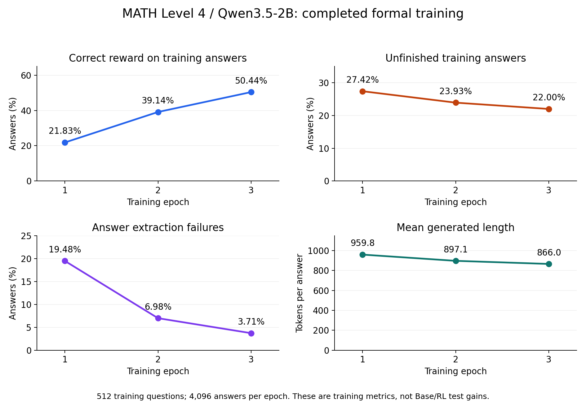

**当前难度大体合适，现有训练值得保留；验证集标签与答案提取问题需要在正式选择检查点前修正。**

本报告检查的是 2026-11-03 下载的 `/Users/xu./Downloads/math_l4_snapshot_20261103`，运行目录为 `outputs/math_l4_v1_fix1`。快照停留在 `DEV CHECKPOINT 128`；它不代表服务器此刻的实时进度。下载内容、冻结实验包和服务器任务均未修改。本次审计只在本地处理已有文件，没有调用模型、GPU 或网络。

正确率已经落在有区分空间的范围。以下数字严格保留当前冻结判分规则，尚未修正本报告发现的问题。

| 观察对象 | 当前证据 | 确认成功比例 | 解读范围 |
|---|---:|---:|---|
| Base 工程抽查，训练前 | 14 次正确，共 32 题，每题 1 次 | 43.75% | 接近目标 40% 至 50%，但只有 32 题 |
| RL checkpoint-128，部分独立验证 | 106 次正确，共 210 次已结束回答 | 50.48% | 52 题各 4 次，另 1 题已完成 2 次 |
| RL checkpoint-128，完整回答的 52 题 | 106 次正确，共 208 次回答 | pass@1 下界 50.96% | 同一题的重复回答不能当成独立题目 |
| 同上，4 次至少有 1 次确认正确 | 41 题，共 52 题 | pass@4 下界 78.85% | 仍有约五分之一题未出现确认正确回答 |

Base 工程集与 RL 验证集不是同一批题，不能将 50.48% 减去 43.75% 当成 RL 提升。当前仅完成验证集的顺序前缀，也不能直接推广为全部 128 道验证题或 200 道测试题的准确率。所有确认成功比例均使用“确认正确数除以请求且已结束的回答数”，保留超时和未确定回答在分母中。

210 次验证回答中，106 次正确、93 次按当前规则判错、11 次因重复检测而未确定。若这 11 次全部正确，比例上界是 55.71%；这个区间只是未确定结果的上下界，不是统计置信区间。已完成 52 题的 pass@4 上界为 46 题，即 88.46%。EOS 表示自然结束，不能等同于答对。

训练确实完成，且训练题上的奖励有所改善。Formal 共 384 步、3 轮，用时 30.83 小时；192 个 adapter 张量在保存的审计记录中发生变化，376 步记录到正梯度。8 个零梯度步骤均由组内奖励完全相同解释，没有发现训练未执行或指标非有限的问题。

| Formal 训练指标 | 第 1 轮 | 第 2 轮 | 第 3 轮 |
|---|---:|---:|---:|
| 正确奖励比例 | 21.83% | 39.14% | 50.44% |
| 未完成／截断比例 | 27.42% | 23.93% | 22.00% |
| 答案提取失败 | 19.48% | 6.98% | 3.71% |
| 请求格式合规比例 | 24.54% | 45.31% | 62.04% |
| 平均生成 tokens | 959.8 | 897.1 | 866.0 |

同一批 512 道训练题比较第 1 轮与第 3 轮，380 题奖励提高、111 题不变、21 题下降。这里的改善包含数学作答、输出格式和结束行为的共同变化；不能把全部奖励增幅解释成推理能力提高。训练使用 2,048-token 上限，验证采用原生上下文加 300 秒限制，两者的绝对正确率也不能直接用来判断过拟合。

文件与日志核对通过：810 个下载文件共 5,622,554,314 bytes；81 个冻结文件、21 个训练完成文件绑定、32 个保存完整状态的检查点均通过校验。训练／验证／测试分别为 512／128／200 题，规范化题面哈希未发现交叉，工程集与 pilot 为训练集的嵌套子集。15,424 条训练奖励和 242 条评估记录均与当前判分器重放一致。Base 权重未下载，因此没有独立重算 Base 权重哈希；文件一致也不保证标准答案在语义上正确。

**实际发现的标签与判分问题如下，正式结果尚未更改。**

| 问题 | 证据 | 影响 |
|---|---|---|
| `precalculus-0660` 多值答案被压成单值 | 原始固定版本题解有两个 boxed 答案：`3/2` 和 `-3`；数据只保留 `-3` | 题目要求列出所有值，不能用单值判分。sample 3 给出完整集合，却被拒绝 |
| `precalculus-0471` 同类问题 | 原始题解给出 `4` 和 `-4`；数据只保留 `-4` | 此题尚未生成回答，问题由题意和原始题解确认，与模型结果无关 |
| `number_theory-0194` 的 sample 1 | 最终明确回答 `#### 378`，数学答案正确；孤立的 `</think>` 使当前规则清空待评分文本 | 只在诊断副本中去掉该标签后判对；反事实 gold 379 仍判错 |

两个多值问题均位于 dev。根因是 `prepare_data.py` 第 112 至 127 行只保留原始题解最后一个 boxed 表达式。对全部 840 道 train/dev/test 的原始题解进行多 boxed 筛查，14 题包含多个框，其中只有上述 2 题包含不同值。另检查了 11 道明确要求全部取值的题目。该筛查没有在训练集或测试集发现同类多框问题，但不等于完成了全部标签的数学证明。

其余 6 条 ambiguous 回答虽然最后改成了正确答案，前文仍保留不同的公开答案，属于冻结的冲突拒绝规则。不能在看过结果后将它们全部改成成功。独立审阅覆盖全部 13 条 ambiguous／extraction_failed、12 条固定随机抽取的正例和 7 个错误或中止例；12 个正例未发现最终答案误判为对，但其中 2 条中间推导有错。因此本实验测量的是最终答案可验证正确性，不能声称证明每一步推理正确。

仅作敏感性检查：按原始题意排除上述 2 道不适配标量任务的题目，其中已有 1 题的 4 次回答进入当前快照，剩余 206 次回答的确认正确比例为 51.46%；再单独纠正已人工确认的 `378` 提取误判后为 51.94%。这不是新的正式成绩或选检查点规则，也没有修改数据。它说明已经确认的问题不会把当前“约一半作答成功”的难度判断彻底改变。

运行耗时主要受到少数长回答影响。当前验证有 181 次 EOS、18 次超时、11 次重复中止；18 次超时占回答数量的 8.57%，却消耗 46.78% 的回答时间。已结束回答平均 55.0 秒、中位数 16.63 秒。若余下 7,726 次回答都保持这个均值，还需约 118 小时；该条件估算不能替代实时 ETA，后续检查点和 Base 的速度可能不同。

建议保留 2B 与 MATH Level 4 的方向，也保留所有权重、检查点和原始回答。目前没有依据立即重训。应先按题意固定多值题处理方式，修复并回归验证 malformed-think 的提取规则，再以独立版本对所有候选检查点统一重放评分；已经保存的回答通常可以本地重判，不必重新生成。旧训练确实使用旧奖励规则，后续报告必须保留这一事实，不能将重判后的训练指标说成原训练过程实际获得的奖励。

在数据与评分问题解决前，当前 dev 成绩只能用于诊断，不宜直接冻结最终检查点。正式效果仍需要在同一批未见测试题、相同模型硬件与停止规则下完成 Base／RL 配对比较。不得根据本次某类题分数低而临时挑选测试题。

复核文件：`integrity_audit.json`、`source_inventory.json`、`training_diagnostic.json`、`evaluation_diagnostic.json`、`quality_review.json`、`diagnostic_sensitivity.json`。对应只读分析脚本保存在同一目录。原始下载快照在审计中未改变。
