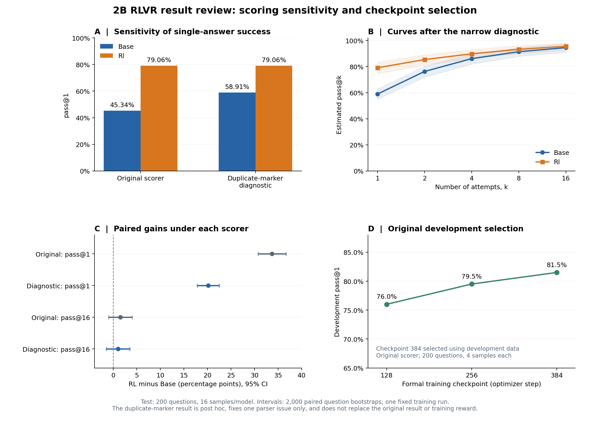

# 2B 主实验下载结果复核

日期：2026-10-31。原始归档：`project/server_results/run_20261031/code/`。本报告和所有诊断输出另存，原始源码、模型、评分、冻结选择和主报告均未修改。

结论：训练与评测产物完整，原始统计可以精确复现；但答案提取器存在重复标记解析缺陷，原始 pass@1 增益对它明显敏感。仅对这一处缺陷做对称修正后，测得增益仍为正，但不能解释为纯数学推理能力增益。应先完善评分审查，再安排结构题与更大模型实验。

## 1. 运行和下载完整性

- 云端实际运行版本为 **v1.2.2**，不是本地已准备的 v1.3；归档没有 v1.3 的恢复协议。不能把本次成功运行当作 v1.3 中断恢复实测。
- engineering、pilot、formal 分别完成 2、96、384 个优化器步，全部工程验收门槛为 true。正式训练涉及 512 道题、3 轮、12,288 个生成回答。
- 正式训练用时 **13.5275 小时**；GPU allocated 峰值 **4.0141 GiB**，reserved 峰值 **4.1543 GiB**。报告包含 371 个有非零有限梯度的更新步；13 个零梯度步不等于训练失败，组内回答奖励一致时没有相对优势信号。
- 开发集 200 道题、每题 4 次采样：checkpoint-128 为 **76.0%**，checkpoint-256 为 **79.5%**，checkpoint-384 为 **81.5%**，按原规则选择 **checkpoint-384**。
- 检查了 8 个训练检查点的关键文件，3 个候选 adapter 的内容哈希匹配；未反序列化优化器或 RNG 文件。
- 核对原始 GSM8K 和处理数据哈希、题号/题目/答案、训练/开发/测试的 ID 和规范化文本隔离、训练源码身份、奖励记录哈希和冻结选择。
- 两组各 3,200 条测试输出，共 6,400 条；题目/样本编号网格完整，提示、生成设置及对应样本随机种子一致。原判分器逐条重放完全一致。
- 使用组合数独立重算 pass@k 和覆盖，再重跑原分析脚本的 2,000 次 bootstrap。summary 完全一致，report、逐题记录及人工抽检 CSV 逐字节一致。

基础模型权重按备份约定未下载，因此本地没有重新计算其文件哈希。隔离检查针对本次训练/评测划分，不证明底座预训练数据无污染或不存在语义近似题。详见 [integrity_audit.json](integrity_audit.json)。

## 2. 原始评分结果

以下为运行时冻结协议下的原始结果，单位为百分比或百分点（pp）。区间为按题配对的边际 95% bootstrap 区间，条件于本次训练，不涵盖训练种子变化。

| 指标 | Base | RL | RL 减 Base | 增益 95% 区间 |
|---|---:|---:|---:|---:|
| pass@1 | 45.34% | 79.06% | +33.72 pp | +30.75 至 +36.66 pp |
| pass@2 | 65.65% | 85.33% | +19.68 pp | +17.11 至 +22.25 pp |
| pass@4 | 81.41% | 89.75% | +8.34 pp | +6.00 至 +10.77 pp |
| pass@8 | 89.75% | 93.21% | +3.46 pp | +1.08 至 +6.02 pp |
| pass@16 | 94.00% | 95.50% | +1.50 pp | -1.00 至 +4.00 pp |

单次增益减去 16 次采样增益为 **+32.22 pp**，区间 **+28.12 至 +35.85 pp**。按原评分，数值关系符合 proposal 的操作性假设。

16 次采样覆盖：两组都覆盖 186 题、仅 Base 覆盖 2 题、仅 RL 覆盖 5 题、两组都未覆盖 7 题。Base 共覆盖 188 题，RL 共覆盖 191 题；没有观察到覆盖收缩。增益区间跨零表示差异不确定，不表示覆盖绝对相同。

## 3. 实际判分缺陷与最小复现

真实记录：`gsm8k-test-001010`，Base 的 sample 0。题意依次得到 Bethany 10 圈、Trey 14 圈、Shaelyn 7 圈、Quinn 5 圈，所求差值为 5。原输出计算正确，末尾写成：

```text
Answer: #### 5
```

判分器分别抽取出标记后的合法候选 `5` 和显式答案前缀后的重复候选 `#### 5`。后者无法作为标量解析，将 `_invalid_candidate` 设为 true，最终否决已经合法提取的 `5`，记为 `extraction_failed`。这是提取实现的缺陷，不能简单解释为模型不会算题。

在独立诊断副本中，仅跳过显式答案前缀后以 `####` 开始的重复候选，仍由原有标记解析器检查答案。六个针对性检查覆盖正确、错误、冲突答案、带单位的非法候选、未修复的 `answer is:` 形式和普通显式答案。未采用“取最后一个数字”或依据 gold 决定提取规则。

该同一规则用于全部 Base 和 RL 回答：Base 有 601 条状态变化，其中 **434 条恢复为正确**、167 条恢复为明确错误；RL 没有状态变化。Base 正确数从 1,451 增至 1,885，RL 仍为 2,530。

## 4. 事后敏感性分析

本节使用同一批已生成文本和原冻结 checkpoint-384，仅修改一处提取逻辑。它不是替换原主结果，也不是完整的新评分规范。

| 指标 | Base | RL | RL 减 Base | 增益 95% 区间 |
|---|---:|---:|---:|---:|
| pass@1 | 58.91% | 79.06% | **+20.16 pp** | **+17.84 至 +22.50 pp** |
| pass@2 | 76.23% | 85.33% | +9.10 pp | +7.05 至 +11.24 pp |
| pass@4 | 86.04% | 89.75% | +3.71 pp | +1.77 至 +5.83 pp |
| pass@8 | 91.38% | 93.21% | +1.83 pp | -0.18 至 +3.95 pp |
| pass@16 | 94.50% | 95.50% | **+1.00 pp** | **-1.50 至 +3.50 pp** |

两种增益之差为 **+19.16 pp**，区间 **+15.66 至 +22.44 pp**。覆盖为 both 187、Base-only 2、RL-only 4、neither 7。原始样本文本、题目、答案、随机种子等非评分字段逐条保持一致，原评分嵌入诊断记录的 `primary_score` 字段。

单次增益减少 **13.56 pp**，描述的是对该提取修正的敏感程度，不能据此把训练收益因果分解为“格式占多少、推理占多少”。其余输出格式边界尚未完全处理，20.16 pp 也不是已被隔离出来的纯推理提升。

另外复核了已记录的训练回答：pilot 的 3,072 条中有 94 条奖励会受这处修正影响；formal 的 12,288 条中有 118 条。实际训练仍使用原奖励，没有被事后改变。相同提取器也用于开发集选点；若将来采用更完整的修正规则，应对三个既有候选统一做选择敏感性分析，保留原冻结选择，并避免按测试成绩选点。

详见 [secondary_comparison.json](secondary_comparison.json)、[nested_marker_diagnostic/score_summary.json](nested_marker_diagnostic/score_summary.json) 和 [training_diagnostic.json](training_diagnostic.json)。

## 5. 对研究假设的解释

目前可以报告：在当前模型、数据、生成预算和评分条件下，RL 模型更稳定地产生可判为正确的单次回答；其单次增益大于 16 次采样增益，该现象在窄范围提取修正后仍存在。

不能据此证明 RLVR 完全没有新增推理能力，也不能证明所有变化只是已有解法的概率重新分配。除了提取缺陷，还存在明显的天花板效应：原 Base pass@16 为 94%，最多再上升 6 pp；当单次增益已经达到 33.72 pp 时，即使 RL pass@16 达到 100%，两种增益之差仍至少有 27.72 pp。该端点对比本身的机制辨别力有限。

16 次失败不意味着无限次采样也无法成功。当前只有一个训练种子，正确终值也不保证推理链正确。数值/关系变体的结构实验尚未运行，不能对这一部分假设下结论。

独立辅助审查抽取了 24 条 Base 提取失败、12 条 RL 提取失败和 8 组成对输出，共 52 条。Base 抽样中发现若干正确计算被格式/重复候选影响；也存在实质数学错误、答案后继续生成和题意歧义。该检查由本助手完成，不是独立人工盲审，不能替代完整语义复核。详见 [answer_quality_review.md](answer_quality_review.md)。

## 6. 训练轮次与下一步

| 正式训练轮次 | 平均训练 reward | 平均 entropy | 平均截断率 | 原评分开发集 pass@1 |
|---|---:|---:|---:|---:|
| 第 1 轮 | 43.21% | 0.6121 | 12.06% | 76.0% |
| 第 2 轮 | 66.92% | 0.3295 | 5.37% | 79.5% |
| 第 3 轮 | 75.61% | 0.2245 | 4.20% | 81.5% |

三个开发集点支持选择第 3 轮，但不能推出再加轮数仍会改善。奖励上升、熵下降与格式适应、数学变化可能同时发生，单靠训练日志无法分离。

建议的后续顺序：

1. 完善并固定评分器规范，覆盖重复标记、显式答案前缀、可接受数值表示、矛盾答案和截断；加入正反例测试。保留本次旧协议结果。
2. 对已有 Base/RL 输出及三个开发集候选做同规则的完整评分敏感性分析。这部分可在本地完成，不需要重新生成回答。
3. 若要研究修正后奖励函数的训练效果，单独启动并记录新版本；不能用评测重评分声称旧训练已使用修正奖励。
4. 对预先生成并冻结的 160 道结构题完成独立审阅，再评测数值/关系变化。当前归档没有 `structural_review.json` 或结构评测结果。
5. 在评分和实验解释清楚后，再安排 4B 规模对照。更大的模型不能自动解决提取缺陷或 pass@16 的天花板。



复核脚本、哈希和全部诊断记录保存在本目录；没有启动服务器任务、修改生产训练代码或覆盖原始实验。
