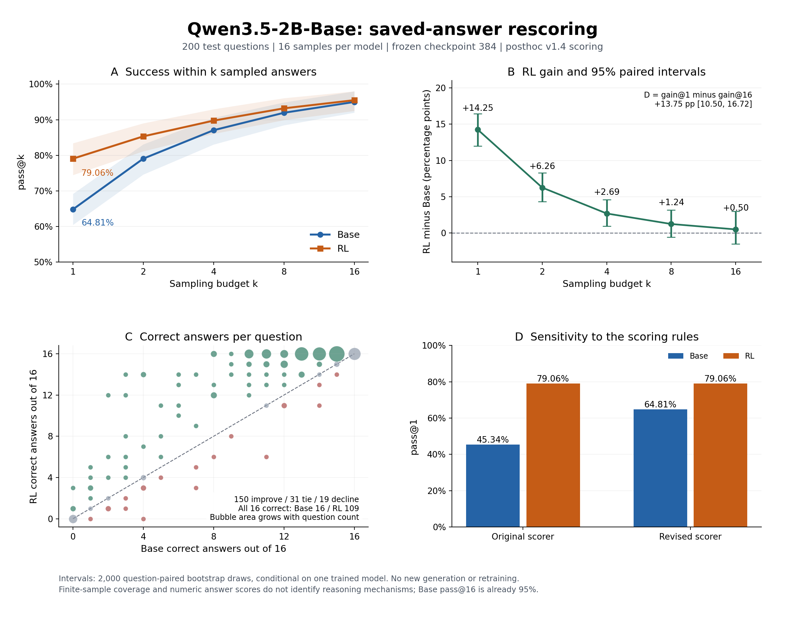

# 2B LoRA-GRPO 实验：v1.4 重评分后的结果解释

此次实验显示，RL 模型在相同生成协议下更容易一次给出被判定为正确的最终数值。单次成功率提高 14.25 个百分点，16 次采样覆盖只增加 0.5 个百分点。逐题观察也支持答对频率提高，但尚不能据此证明模型没有获得新推理能力。

数据是旧训练产生的固定回答，使用 v1.4 判分器进行事后复核。200 道测试题，每题 Base/RL 各 16 个回答，共 6,400 条；开发集三个候选共 2,400 条另作选点敏感性检查。训练仍使用原奖励，主测试保留原冻结 checkpoint-384。

## 单次成功率与有限采样覆盖

| 指标 | Base | RL | RL−Base（百分点） | 95% 配对 bootstrap 区间（百分点） |
|---|---:|---:|---:|---:|
| pass@1 | 64.81% | 79.06% | +14.25 | [11.97, 16.44] |
| pass@2 | 79.07% | 85.33% | +6.26 | [4.33, 8.29] |
| pass@4 | 87.06% | 89.75% | +2.69 | [0.94, 4.59] |
| pass@8 | 91.96% | 93.21% | +1.24 | [−0.57, 3.17] |
| pass@16 | 95.00% | 95.50% | +0.50 | [−1.50, 3.00] |

pass@1 是这些随机采样回答的平均成功率，不是温度为零的单独贪心评测。pass@k 表示采样 k 次至少出现一个正确答案的成功率；它不意味着模型能自行从 k 个答案中选出正确的那个。

在本次训练条件下，低预算的增益较清楚：pass@1/2/4 的边际区间都高于零。pass@8/16 的区间跨零，不能排除小幅增减，不能表述为“完全没有变化”。区间来自 2,000 次按题配对 bootstrap，只涵盖测试题不确定性，不包含不同训练种子之间的差异，也不是五个指标的同时置信带。

## 提升集中在更经常答对已观察到能答对的题

200 题中，150 题的采样正确数增加，31 题持平，19 题减少。这是每题 16 次采样的计数对比，没有进行逐题显著性判定。16 次全部答对的题由 Base 的 16 题增加到 RL 的 109 题，也不能据此断言后者未来永远答对这些题。

例如房屋翻修收益题 `gsm8k-test-000002`：Base 在 16 次中答对 4 次，RL 答对 14 次。两者都已在这 16 次里出现正确答案，因此 pass@16 都为 1，但单次成功率估计从 25% 提高到 87.5%。这解释了为何低采样预算的差距可以很大，高预算的差距却很小。

也有明确退步例子。山上梳子题 `gsm8k-test-000419` 中，梳子从 10,000 英尺下落 4,000 英尺，Oliver 位于 3,000 英尺，应该爬升 3,000 英尺。Base 答对 4/16，RL 为 0/16；RL 有 15 次输出 7,000，保留的回答显示它忽略了梳子已经下落这一条件。训练可提高整体表现，同时在个别题上更稳定地犯错。

| 16 次中观察到的覆盖关系 | 题数 |
|---|---:|
| 两者都至少答对一次 | 188 |
| 只有 Base 答对 | 2 |
| 只有 RL 答对 | 3 |
| 两者都没答对 | 7 |

覆盖为 190→191 题，净增加 1 题。“仅 RL 覆盖”不等于证明新能力，因为 Base 的 16 次失败不能证明更大预算下仍然失败。

净正确回答增加 456 条。双方都覆盖的 188 题贡献净增 456 条；仅 RL 覆盖的三题合计有 5 条正确回答，仅 Base 覆盖的两题也合计 5 条，恰好抵消。该计数关系与“提高已有覆盖题的成功频率”相符，但这些组按观察结果划分，不能据此作因果机制分解。

## 对原假设的支持与天花板限制

主实验的操作性假设是单次增益为正，且大于 16 次采样增益。以百分点计算：

```math
\Delta_1 = 79.0625 - 64.8125 = 14.25.
```

```math
\Delta_{16} = 95.5 - 95.0 = 0.50.
```

```math
D = \Delta_1 - \Delta_{16} = 14.25 - 0.50 = 13.75.
```

D 的 95% 配对区间为 [10.50, 16.72] 个百分点。两个方向在这次固定模型和事后判分规则下均得到支持。

但 Base 的 pass@16 已为 95%，产生天花板效应（ceiling effect）：

```math
\operatorname{pass@16}_{\mathrm{RL}} \le 100\%
\quad\Longrightarrow\quad
\Delta_{16} \le 100 - 95 = 5.
```

```math
D = 14.25 - \Delta_{16} \ge 14.25 - 5 = 9.25.
```

因此，在当前点估计下，即使 RL 达到 100% 的 pass@16，D 仍为正。D 不能单独识别“只是重分配已有能力”的机制。可以报告有限预算下的答对可靠性改善，不能把结论扩展成“RLVR 不会产生新推理能力”。

## 判分修正改变了多少结论

原评分把 Base pass@1 低估为 45.34%；修正后为 64.81%，RL 仍为 79.06%。原先 33.72 个百分点的差距缩小为 14.25 个百分点。这说明原评分对 Base 的格式和答案提取造成了严重偏差，旧增益不能继续当作数学能力提升报告。

v1.4 的 Base 有 627 条回答恢复正确、4 条因保守标题规则变为提取失败，净增加 623 条。四条降级记录的数值可理解且与 gold 相同，属于已记录的保守漏判，不能称为数学错误。其余规则仍拒绝未约定的自然语言、单位和冲突候选。

剩余提取不确定性可以作一个透明的极端计数检查。Base 还有 289 条提取失败及 8 条歧义回答。假设把这 297 条全部额外算对，同时不给 RL 的未解析回答补分：

```math
N_{\mathrm{Base,upper}} = 2074 + 289 + 8 = 2371,
```

```math
\widehat p_{\mathrm{Base,upper}} = 2371 / 3200 = 0.7409375,
```

```math
\widehat p_{\mathrm{RL}} - \widehat p_{\mathrm{Base,upper}}
= (2530 - 2371) / 3200
= 159 / 3200
= 0.0496875.
```

样本差距仍为 4.97 个百分点。这只在“已解析标签和标准答案可信”的假设下说明，剩余未解析的 Base 回答不足以抹平全部数值分数差距。它不是纯数学推理提升的下界，也没有为该新构造量计算置信区间。个别 gold 自身存在解释疑点，例如汽车折旧题的线性与复利口径，因此仍需要对推理和题目语义作独立复核。

## 研究目标还缺哪些证据

开发集 128/256/384 步得分仍为 76.0%/79.5%/81.5%，重评分未改变候选排序。这个结果能支持保留原 checkpoint-384，不能证明继续增加训练轮数一定更好。

此次已证实 2B 在当前任务和训练设置下能获得清楚的输出成功率提升，没有“太小而完全学不动”的现象。当前主要证据缺口是奖励协议与推理有效性的确认，以及尚未执行的结构泛化评测。更换模型规模本身不能修复这些证据缺口。

后续可先固定判分协议并做独立盲审，再用新奖励做确认训练；结构题在独立审阅后比较数值变体与关系变体。若资源允许，多训练种子可以检验结果是否稳定。上述实验尚未执行，本次分析没有启动新训练或修改原始结果。

适合报告的表述：

> 在 200 道 GSM8K 测试题、每题 16 次采样和事后统一重评分下，LoRA-GRPO 将 Qwen3.5-2B-Base 的单次成功率从 64.81% 提高到 79.06%，而 16 次采样覆盖从 95.0% 变为 95.5%。结果支持有限预算下的答对可靠性提升；由于高采样天花板、单个训练种子和评分修正发生在实验之后，尚不能判断推理能力边界是否改变。

> Under posthoc rescoring of 16 samples per model on 200 GSM8K test questions, LoRA-GRPO increased pass@1 from 64.81% to 79.06%, while observed pass@16 changed from 95.0% to 95.5%. The results support improved answer reliability at a limited sampling budget, but do not establish whether the model's reasoning boundary changed.



图 1 / Figure 1. 原始回答与冻结 checkpoint 保持不变；阴影和误差线为条件于本次训练结果的 95% 边际区间。图 C 的大小表示该正确次数组合中的题数，颜色区分增加、持平与减少。图 D 展示原评分和统一修正后的差别。

数据来源：`../../rescore_v1_4/main_analysis/summary.json`、`per_question.jsonl`、`../../rescore_v1_4/diagnostics.json` 及原始回答。新增描述性统计和源 ready 文件哈希保存在同目录 `additional_statistics.json`；复现脚本为 `analyze_results.py`，没有改变原重评分结果。
